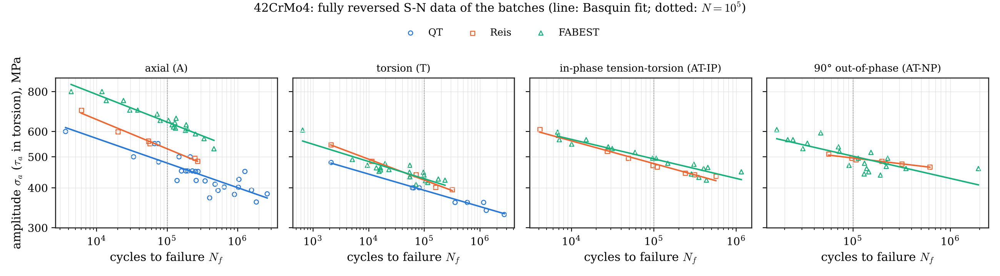
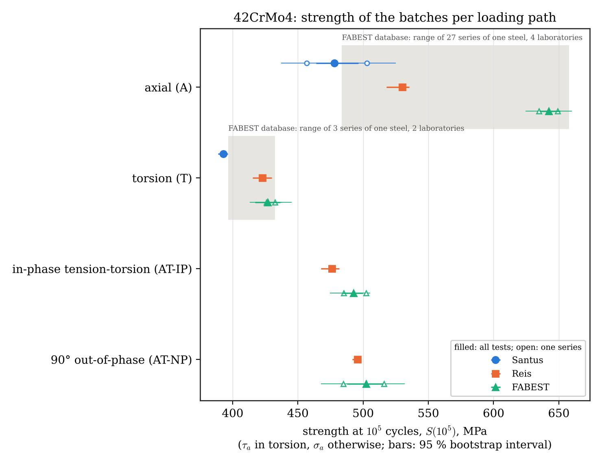
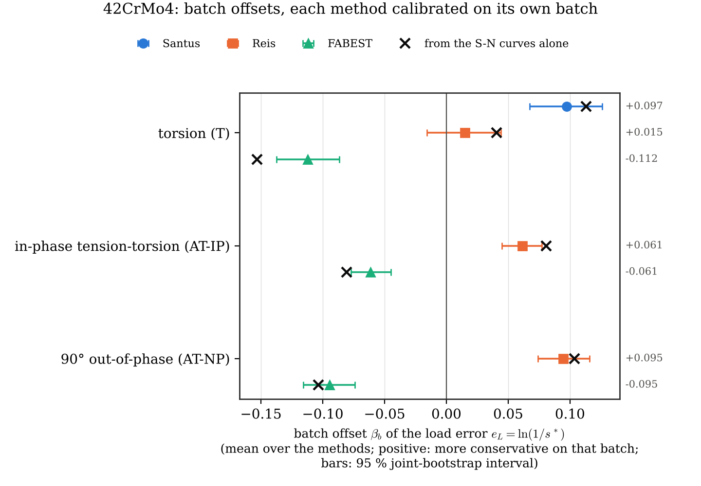
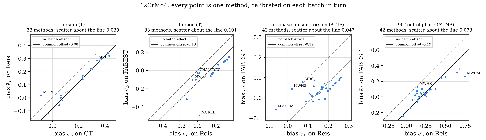
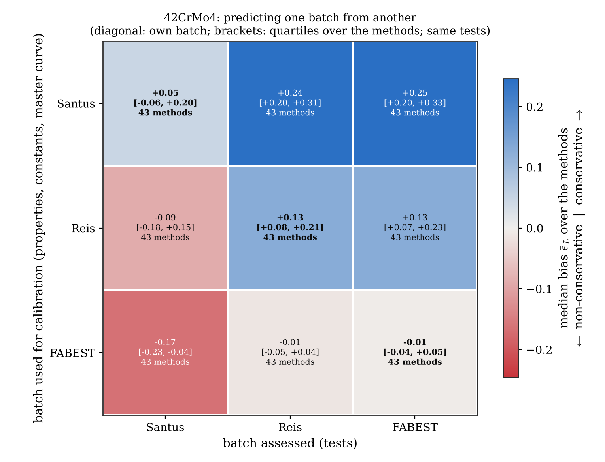
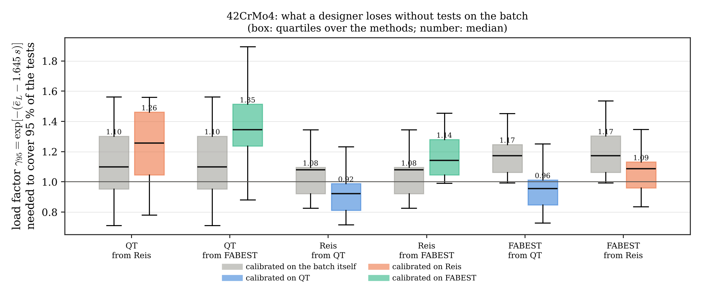
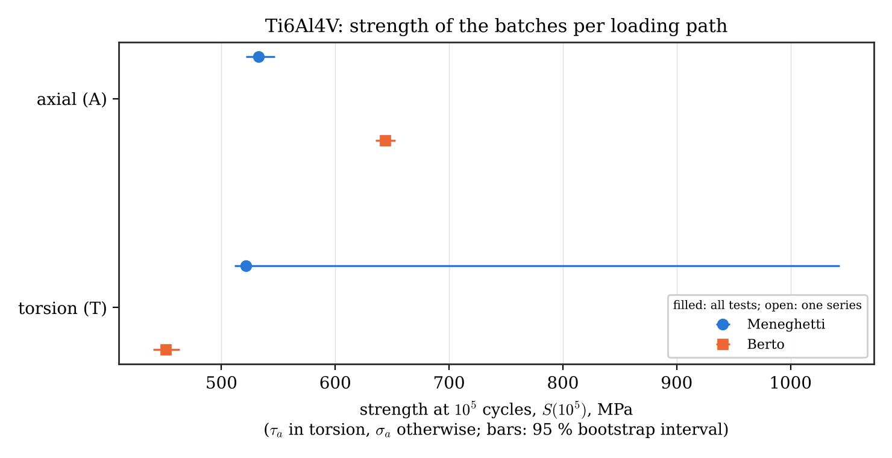

# Cross-batch comparison

Issue [#71](https://github.com/andreachiocca/multiaxial-fatigue/issues/71). Several workbooks hold
tests on the same material from different sources. This page asks:

1. Do the batches of one material differ consistently, before any fatigue criterion is applied?
2. Does a method's error change from batch to batch when it is calibrated on each batch in
   turn, and is the change specific to the method?
3. What happens when a batch is predicted from another batch (cross-batch transfer)?

## Short answer (42CrMo4, three batches)

- **The batches differ mainly in their axial strength.** At $10^5$ cycles the axial strengths
  are 478, 530 and 642 MPa (QT, Reis, FABEST). The torsion strengths are 393, 423 and 427 MPa,
  and the two batches with multiaxial tests agree within 3 % on both multiaxial paths.
- **Part of it is test series, part is material batch, and the batch part is mostly the
  strength level.** The FABEST database is one material batch tested in 27 axial series in
  four laboratories; between its series the axial strength scatters with SD 0.081 in ln S. The
  three 42CrMo4 datasets scatter with SD 0.150. The batch part, about 0.13, falls to about 0.05
  once the strengths are divided by the tensile strength Su. In torsion the datasets scatter no
  more than the FABEST series do.
- **Each batch shifts all methods together.** Calibrated on its own batch, every method moves
  by nearly the same amount from one batch to the next. The shift can be computed from the S-N
  data alone.
- **The transfer shift does not depend on the method.** Predicting batch B from batch A changes
  every method's bias by the same amount, equal to three decimals to a quantity computed from
  the S-N curves. A transfer therefore tests the data of the two batches, not the methods.
- **Direction matters for safety.** Calibrating on the softer QT batch is conservative for the
  other two. Calibrating on Reis or FABEST is non-conservative for QT: the load must be reduced
  by a further 15–25 % to cover 95 % of the QT tests.

These are descriptive results for one steel and three sources. They do not rank the methods in
general.

## What is a batch?

Three terms are kept apart on this page:

- **Material batch**: one lot of material (one heat and heat treatment).
- **Test series**: one S-N curve of one campaign: specimen type, machining, laboratory, machine.
- **Dataset**: one workbook. It is what the comparison can compare, and it confounds the
  material batch with its test series.

The maintainer's rules:

- **d101**: tests by different author groups are different material batches.
- **Santus 2018 and Benedetti 2022 (`42CrMo4_QT`)**: one material batch, two test series. This
  is decided on the data (d101, revised): their axial strengths differ by 0.096 in ln S, less
  than one standard deviation of the difference between two series of one batch
  ($0.081\sqrt2 = 0.115$, from FABEST). Nothing in the data indicates two batches. Benedetti
  2022 states that its material supply differs from that of its ref. [17], which is Benedetti,
  Santus and Berto 2019 (IJF 126), not Santus 2018; so the source does not separate them either.
- **FABEST (d105)**: every series of the database comes from one material batch, ordered once
  and tested in several laboratories. Its scatter between series is therefore the pure
  test-series scatter, the yardstick used below.

Families are declared in
[`examples/data/material_families.json`](../examples/data/material_families.json).

| Family | Batch | Source | Su / Sy (MPa) | Specimens | R = −1 failures (A / T) | Multiaxial failures |
| --- | --- | --- | --- | --- | --- | --- |
| 42CrMo4 | `42CrMo4_QT` | Santus 2018 + Benedetti 2022 (one batch, two series) | 875 / 727 | solid, axial d = 5, torsion d = 14 mm | 27 / 9 (+ 9 torsion with mean shear) | none |
| 42CrMo4 | `42CrMo4_Reis` | Anes/Reis 2014 | 1100 / 980 | solid, d = 6.3 / 7.5 mm | 6 / 5 | 8 in-phase, 6 at 90° |
| 42CrMo4 | `42CrMo4_FABEST` | FABEST, PBS series | 1111 / 1035 | thin-walled tube 8.1/7 mm | 20 / 20 | 18 in-phase, 21 at 90° |
| Ti6Al4V | `Ti6Al4V` | Meneghetti 2018 (Delahay 2006 rows removed, d109) | 980 / 915 (Meneghetti only, d108) | — | 6 / 4 | none |
| Ti6Al4V | `Ti6Al4V_Berto` | Berto 2015 | 978 / 894 | — | 9 / 8 (+ 31 torsion with mean shear) | none |

### What "batch" confounds

A batch defined by its authors differs from the next one in several ways at once. For the three
42CrMo4 batches (workbooks, `Experimental_Data/PROVENANCE.md` and the FABEST source file):

| Factor | QT | Reis | FABEST | Separable with these data? |
| --- | --- | --- | --- | --- |
| Heat treatment (Su, MPa) | 875 | 1100 | 1111 | Partly: strengths can be divided by Su |
| Specimen | solid; axial d = 5, torsion d = 14 mm | solid; d = 6.3 and 7.5 mm | tube 8.1/7 mm | No: one geometry per batch |
| Stress gradient in torsion | yes (solid bar) | yes (solid bar) | almost none (thin wall) | No |
| Shear stress reference | nominal elastic, surface | nominal elastic, surface | "net section", radius not stated (outer or mean: 7 %) | No |
| Torsion failures above $S_y/\sqrt3$ | 11 % | 0 % | 5 % | — |
| Surface finish | not recorded | not recorded | turned, two machining variants (FAB06x, FAB07x) | Only inside FABEST |
| Laboratory and machine | one source group | one source group | PBS, Instron 8874 | Only inside the FABEST database |
| Frequency (Hz) | 15–20 and 150 | not recorded | 5–39 | No |
| Fatigue limits in the Summary | 433 / 344 at $2\times10^6$ (paper Table 12: 412 / 328 at $5\times10^6$) | 452 / 372: trend lines at $10^6$, extrapolated | 517 / 367: Basquin at $10^6$, below the run-outs | No: three definitions |

So a difference between two datasets cannot be assigned to the material from one comparison.
The FABEST database separates the two parts: one material batch tested in several laboratories,
on several specimen types and finishes. Its scatter between series is subtracted from the
scatter between datasets to estimate the material-batch part
([variance split](#the-batches-without-any-method)).

Series inside a dataset (`reference_series.csv`):

- **QT.** The Santus axial series gives 457 MPa at $10^5$ cycles (95 % interval 437–471), the
  Benedetti series 503 MPa (485–525). The difference (10 %) is inside the scatter between
  FABEST series of one batch.
- **FABEST.** FAB06x and FAB07x differ in the turning parameters (cutter nose radius 0.4 and
  0.8 mm, `Production` sheet) and in strength by 1.5–6 % depending on the path.

## How to run

```bash
uv run python examples/batch_comparison.py all <tmp_dir> --jobs 4   # pipeline runs + analysis
uv run python examples/batch_comparison.py analyse <tmp_dir>        # analysis of existing runs
uv run python examples/batch_comparison.py check                    # are the committed results current?
```

`run` calls `multifat-pipeline` on each batch (own batch) and once per design batch with
`--design-material` (transfer). `analyse` writes the tables to
`examples/data/batch_comparison/<family>/` and the figures to
`docs/images/batch_comparison_<family>_*.png`.

The manifest records the registered models, the implementation revision, the supplied constants
and the dataset fingerprints. `tests/test_batch_comparison.py` fails when one of them changes,
so the results are regenerated with every new method or data change
([adding methods](adding-methods.md)).

| Module | Content |
| --- | --- |
| `examples/batch_reference.py` | method-free part: S-N strengths, ratios, FABEST yardstick |
| `examples/batch_comparison.py` | pipeline runs, method statistics, staleness check |
| `examples/batch_plots.py` | figures |

## Method

### Quantities

The method error is the load-equivalent error of an assessed failure,

$$e_L = \ln\frac{1}{s^*}$$

where $s^*$ scales the load so that the method predicts the observed life
([#37](https://github.com/andreachiocca/multiaxial-fatigue/issues/37)). $e_L > 0$ is conservative.

Loading paths: `A` (axial), `T` (torsion), `AT-IP` (in-phase tension–torsion), `AT-NP`
(out-of-phase), with `+mean` for a non-zero mean stress. Batches are compared within a path
only; pooling paths would compare the batches on different loads. On both multiaxial paths the
two batches use the same ratio $\tau_a/\sigma_a = 1/\sqrt3$.

**Load or life domain.** The comparison is made in the load domain. A life error is
$k\,e_L$, with $k = -1/b$ the slope of the S-N curve, and $k$ differs between batches and paths
(11–13 on the axial curves, 15–20 in torsion here). A life-domain comparison would mix the batch effect with
the slope. As a guide, $e_L = 0.1$ is a factor of about 3 in life on the axial curves.

### Method-free part

`batch_reference.py` works on the R = −1 failures only:

- **Strength** $S(10^5)$: Basquin fit of log amplitude on log life, per batch, path and series,
  with a 95 % bootstrap interval. $10^5$ cycles lies inside the tested lives of every 42CrMo4
  batch; a strength outside the tested lives is flagged `extrapolated`.
- **Relative strength** $q(B\,|\,A)$: the mean of $\ln[\,\mathrm{amp}_i / S_{A}(N_i)]$ over the
  tests of batch B on a path, where $S_A$ is the axial Basquin curve of batch A.
- **FABEST yardstick**: $S(10^5)$ of every unnotched R = −1 axial and torsion series of the
  FABEST source file, and the scatter of $\ln S$ between them.

Why $q$ matters: for a damage parameter that is homogeneous of degree one in the loads and
calibrated on the axial curve of batch A, the error of a test is

$$e_L = \ln c_m + \ln\frac{\mathrm{amp}}{S_A(N)}$$

with $c_m$ a constant of the method on that path. Two consequences follow, with no method
involved:

- own batch: the batch offsets are $q(b\,|\,b)$, centred over the batches compared;
- transfer: the bias on B minus the bias on A is $q(B\,|\,A) - q(A\,|\,A)$.

### Method part

| Output | Statistic |
| --- | --- |
| `own_cells.csv` | per method, batch and path: $n$, bias with a 95 % bootstrap interval, SD, RMS, share within ±20 % of the load |
| `own_two_way.csv`, `own_offsets.csv` | additive decomposition of the cell biases per path, with joint-bootstrap intervals and the method-free prediction of each offset |
| `own_runout_sensitivity.csv` | offsets with the run-outs entered as censored observations |
| `transfer_cells.csv`, `transfer_penalty.csv` | transfer statistics, and RMS own batch against transfer on the same tests |
| `transfer_prediction.csv` | transfer shift (median over the methods) against its method-free prediction |
| `transfer_designer.csv` | load factor that covers 95 % of the tests, own batch against transfer |

The decomposition is

$$\bar e_{mb} = \mu + \alpha_m + \beta_b + (\alpha\beta)_{mb}$$

with $\beta_b$ the batch offset common to all methods, $\alpha_m$ the method effect and
$(\alpha\beta)_{mb}$ the method × batch interaction. It uses the methods that are finite on
every assessed failure of the batches compared.

### Statistical choices

- **Joint bootstrap.** All methods are evaluated on the same specimens, so their errors are
  strongly correlated. The specimens are resampled within each batch and the same resample is
  used for every method. This gives the interval of each offset and the size of the interaction
  that sampling alone would produce (`noise_rms`).
- **Effect sizes with intervals, not p-values.** An earlier version reported Kruskal–Wallis
  tests with a Benjamini–Hochberg correction. They were removed:
  - The specimens of one S-N curve share the lot, the machine and the laboratory. A test at
    specimen level only says that two test series differ, which the intervals already show.
  - With two or three batches, nothing can be inferred about a population of batches. A
    random-effect model for the batch would have one or two degrees of freedom. The spread
    between batches is therefore compared with an external yardstick, the FABEST series, not
    tested.
- **What an interval means.** It describes the tests of that batch. It does not include the
  variation between series, which the FABEST yardstick shows to be larger.
- **Small cells.** Reis has 5–8 failures per path. Its offsets have intervals of about ±0.03,
  so a difference below about 0.05 between Reis and another batch cannot be resolved.
- **Run-outs.** A run-out bounds $e_L$ from below. Where the damage parameter is homogeneous,
  the bound is $\ln(DP/DP_\mathrm{fit})/d$ at the run-out life, and the bias is re-estimated by
  maximum likelihood for a normal sample with right-censored values. This is a sensitivity
  check, limited to the homogeneous methods.
- **Multiple comparisons.** The conclusions rest on a few quantities: at most three offsets per
  path and one interaction. The per-method intervals are given for reading, not for selecting
  significant methods.
- **Rank correlations between batches** are not reported: ties (the limit-based methods share
  one torsion error) and the common offsets make them uninformative.

### Kinds of evidence

| Result | Kind |
| --- | --- |
| Transfer reproduces the design batch's own design rows and master curve | numerical verification (`tests/test_transfer.py`) |
| Statistics recover known offsets, shifts and censored means | numerical verification on synthetic data (`tests/test_batch_comparison.py`) |
| Strengths, ratios, batch offsets, interaction | descriptive statistics of experimental scatter |
| Own-batch errors | fit: the design set comes from the same batch |
| Transfer errors | predictive validation, for these batch pairs only |

## Results: 42CrMo4

Run of 10 November 2026. 43 methods ran on every batch. TVEIT2025 was skipped (constants not
supplied), GOLOS is out of scope, and SSF runs only where its published surface applies.

### The batches without any method





Strength at $10^5$ cycles (`reference_series.csv`, pooled series):

| Path | QT | Reis | FABEST | Range (ln) |
| --- | --- | --- | --- | --- |
| A, MPa | 478 | 530 | 642 | 0.30 |
| A / Su | 0.546 | 0.482 | 0.578 | 0.18 |
| T, MPa | 393 | 423 | 427 | 0.08 |
| AT-IP ($\sigma_a$), MPa | — | 476 | 493 | 0.03 |
| AT-NP ($\sigma_a$), MPa | — | 496 | 502 | 0.01 |
| T / A | 0.82 | 0.80 | 0.66 | — |

The yardstick, from the FABEST database (`fabest_summary.csv`; one material batch, d105):

| Series of one batch | Series | Laboratories | $S(10^5)$, MPa | SD of ln S | Range (ln) |
| --- | --- | --- | --- | --- | --- |
| Axial, all unnotched | 27 | 4 | 484–658 | 0.081 | 0.31 |
| Axial, one drawing (tube 8.1/7 mm) | 7 | 3 | 561–655 | 0.063 | 0.15 |
| Torsion, all unnotched | 3 | 2 | 397–432 | 0.046 | 0.09 |

Variance split (`reference_components.csv`). The variance of ln S between the datasets is the
sum of a material-batch part and a test-series part; the latter is taken from FABEST:

$$s_\mathrm{batch}^2 = \max\left(s_\mathrm{datasets}^2 - s_\mathrm{series}^2,\ 0\right)$$

| Path | Strength | $s_\mathrm{datasets}$ (3 datasets) | upper 95 % | $s_\mathrm{series}$ (FABEST) | $s_\mathrm{batch}$ |
| --- | --- | --- | --- | --- | --- |
| A | $S$ | 0.150 | 0.94 | 0.081 (27 series) | 0.126 |
| A | $S/S_u$ | 0.093 | 0.59 | 0.081 | 0.047 |
| T | $S$ | 0.046 | 0.29 | 0.046 (3 series) | 0.000 |
| T | $S/S_u$ | 0.090 | 0.56 | 0.046 | 0.077 |

Reading:

- **Axial: the material batch matters, and mostly through its strength level.** The datasets
  spread almost twice as much as the series of one batch. Dividing by Su leaves a batch part of
  about 0.05, below the series scatter.
- **Torsion: no batch part is visible.** The datasets spread exactly as much as the FABEST
  series, and dividing by Su makes the spread larger: the torsion strength of these three
  datasets does not follow Su. The FABEST torsion yardstick rests on three series only.
- **The uncertainty is large.** Three datasets give two degrees of freedom; the upper end of
  the 95 % interval of $s_\mathrm{datasets}$ is six times the estimate. The split is a point
  estimate, not a test.
- **Multiaxial strengths agree** between the two datasets that have them (3 % in-phase, 1 % out
  of phase).
- **The torsion-to-axial ratio separates the tubes (0.66) from the solid bars (0.80–0.82).** All
  three are above the von Mises value 0.577. A stress gradient in solid torsion bars raises the
  nominal torsion strength, which fits the direction of the difference. The ratio is confounded
  with the batch, so this stays a hypothesis.
- **The axial strength over Su (0.48–0.58) is plausible for a quenched and tempered steel.**

### Each method calibrated on its own batch



| Path | Methods | $\beta_\mathrm{QT}$ | $\beta_\mathrm{Reis}$ | $\beta_\mathrm{FABEST}$ | Interaction RMS | From sampling | Method SD |
| --- | --- | --- | --- | --- | --- | --- | --- |
| T | 33 | +0.097 [0.067, 0.126] | +0.015 [−0.016, 0.044] | −0.112 [−0.137, −0.087] | 0.043 | 0.008 | 0.141 |
| AT-IP | 43 | — | +0.061 [0.045, 0.077] | −0.061 | 0.023 | 0.004 | 0.047 |
| AT-NP | 42 | — | +0.095 [0.074, 0.116] | −0.095 | 0.036 | 0.002 | 0.157 |

- **The offsets are well determined** and follow the method-free prediction (crosses in the
  figure): in torsion +0.113, +0.040 and −0.153 against the observed +0.097, +0.015 and −0.112.
  The prediction is exact only for methods calibrated on the axial curve; the limit-based
  methods also depend on the Summary limits.
- **The interaction is real but small.** It is 5–18 times what sampling would produce, yet two
  to three times smaller than the offsets and, except in-phase, than the spread between methods.
- **In-phase, the batch matters as much as the method**: the offset (±0.06) exceeds the method
  SD (0.047).
- **Run-outs do not change the picture.** Entering them as censored observations moves the
  offsets by at most 0.014 (`own_runout_sensitivity.csv`).



Each point is a method. A pure batch offset puts all points on a line of unit slope. The
methods that leave the line most are MOREL (torsion), MWCM and LI (out-of-phase) and MWHS, whose
design curve is the torsion curve.

### Predicting one batch from another



Shift of the bias when batch B is predicted from batch A, median over the methods, against the
method-free prediction $q(B|A) - q(A|A)$ (`transfer_prediction.csv`):

| Design → target | Path A | Path T | Path AT-IP | Path AT-NP |
| --- | --- | --- | --- | --- |
| QT → Reis | +0.112 / +0.112 | +0.044 / +0.044 | — | — |
| QT → FABEST | +0.298 / +0.298 | +0.039 / +0.039 | — | — |
| Reis → QT | −0.088 / −0.088 | −0.020 / −0.020 | — | — |
| Reis → FABEST | +0.191 / +0.191 | −0.007 / −0.007 | +0.029 / +0.030 | −0.015 / −0.015 |
| FABEST → QT | −0.286 / −0.286 | −0.023 / −0.023 | — | — |
| FABEST → Reis | −0.189 / −0.189 | +0.006 / +0.006 | −0.030 / −0.030 | +0.012 / +0.012 |

(observed / predicted)

- **The shift is the same for every method** (quartiles within 0.01) and equals the prediction.
  A transfer between batches measures how the S-N data of the two batches lie against each
  other. It does not discriminate between methods; their ranking in a transfer is inherited
  from their own-batch bias.
- **Nearly all of the shift is on the axial path**, in line with the method-free comparison.
- **Direction.** From QT to the stronger batches the median bias is +0.24 to +0.25
  (conservative). From Reis or FABEST to QT it is −0.09 and −0.17 (non-conservative). Between
  Reis and FABEST it is +0.13 and −0.01.



The load factor $\gamma_{95} = \exp[-(\bar e_L - 1.645\,s)]$ is the factor by which the load
allowed by a method must be divided so that 95 % of the tests are on the safe side, under a
normal model of $e_L$ (`transfer_designer.csv`, median over the methods, same tests):

| Target | Own batch | From QT | From Reis | From FABEST |
| --- | --- | --- | --- | --- |
| QT | 1.10 | — | 1.26 | 1.35 |
| Reis | 1.08 | 0.92 | — | 1.14 |
| FABEST | 1.17 | 0.96 | 1.09 | — |

Without tests on the batch, a designer who takes the constants from a stronger lot of the same
steel needs 15–25 % more margin on the load.

### SSF on a batch it was not fitted on

The SSF surface is published for the Reis batch (decision [d103](decision-log.md#d103)). Applied
to FABEST with Reis's torsion curve (`transfer_cells.csv`):

| Path ($n$) | SSF bias | SSF RMS | Median RMS, other 43 methods |
| --- | --- | --- | --- |
| T (20) | −0.003 | 0.040 | 0.089 |
| AT-IP (18) | +0.002 | 0.040 | 0.192 |
| AT-NP (21) | −0.028 | 0.075 | 0.167 |
| A (20) | +0.168 | 0.172 | 0.193 |

The explanation is in the method-free comparison: the torsion and multiaxial curves of Reis and
FABEST coincide, and SSF is designed on the torsion curve. Its error appears on the axial path,
where the two batches differ. On Reis itself (in sample) its RMS is 0.04 on every path. SSF is
skipped on QT, whose torsion tests with a mean shear are outside its R = −1 scope.

## Results: Ti6Al4V



- **No own-batch comparison is possible.** The `Ti6Al4V` design tests do not identify a master
  curve: 6 axial failures over 0.39 decades of life with a slope indistinguishable from zero
  ($b = -0.002 \pm 0.027$), and 4 torsion failures for MWHS. Since decision
  [d106](decision-log.md#d106) the master-curve methods are skipped there, and only the native
  MOREL runs. FS, FIN, MDC, MMCCM and LIUMAHADEVAN cannot be calibrated on it either.
- **Transfer from Berto.** `Ti6Al4V` can still be predicted from `Ti6Al4V_Berto` (42 methods,
  Berto's curves and Summary). The shift equals its method-free prediction: −0.227 on the axial
  path and +0.147 in torsion (`transfer_prediction.csv`). The reverse transfer is skipped for the
  same reason as the own batch.
- **Data checks** ([#24](https://github.com/andreachiocca/multiaxial-fatigue/issues/24)):
  - The Meneghetti torsion amplitudes (474–550 MPa) equal the axial ones (523–550 MPa) at
    similar lives, a ratio $\tau_a/\sigma_a \approx 1$ (Berto: 0.70). Checked against the
    paper: the values are nominal shear amplitudes, and the ratio comes from an almost flat
    axial curve (inverse slope 50, against 22 in torsion); at $2\times10^6$ cycles the paper
    gives 0.88. Not a data error.
  - The Summary of `1_Ti6Al4V` averaged the Meneghetti and Delahay properties, although every
    failure is Meneghetti's. Since decision [d108](decision-log.md#d108) an overlay keeps the
    Meneghetti values only (Su 980, Sy 915, limits 500 / 422.5 MPa). The 4 Delahay rows, endurance
    limits of another batch entered as run-outs, are removed ([d109](decision-log.md#d109)).
    They now form the fatigue-limit dataset `17_Ti6Al4V_Delahay`, which is not part of this
    comparison: its errors are fatigue indices on limit states, not load errors on failures.

## Open questions

1. **More FABEST series.** Importing the other unnotched FABEST series
   ([#65](https://github.com/andreachiocca/multiaxial-fatigue/issues/65)) would let the
   series scatter be estimated per laboratory and specimen type, and would firm up the torsion
   yardstick, which rests on three series.
