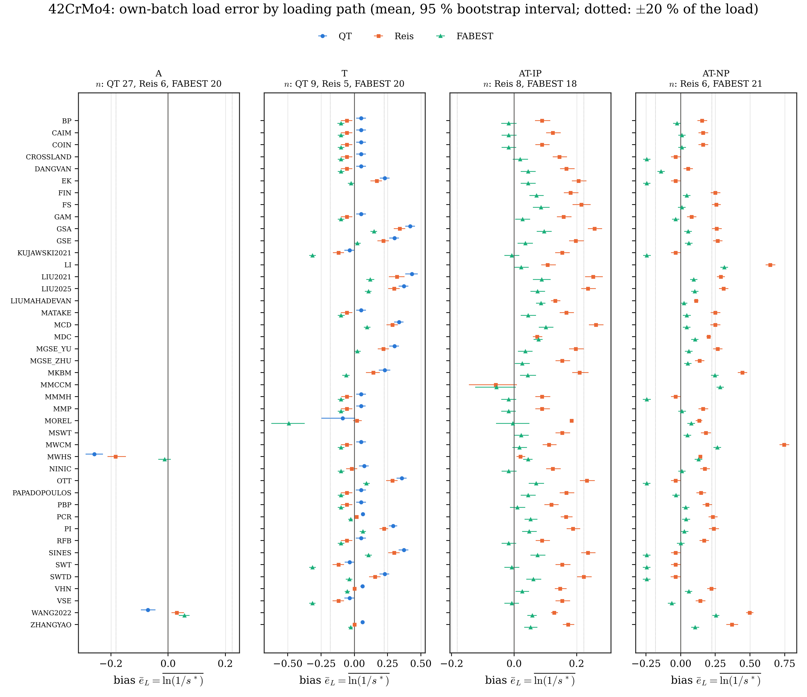
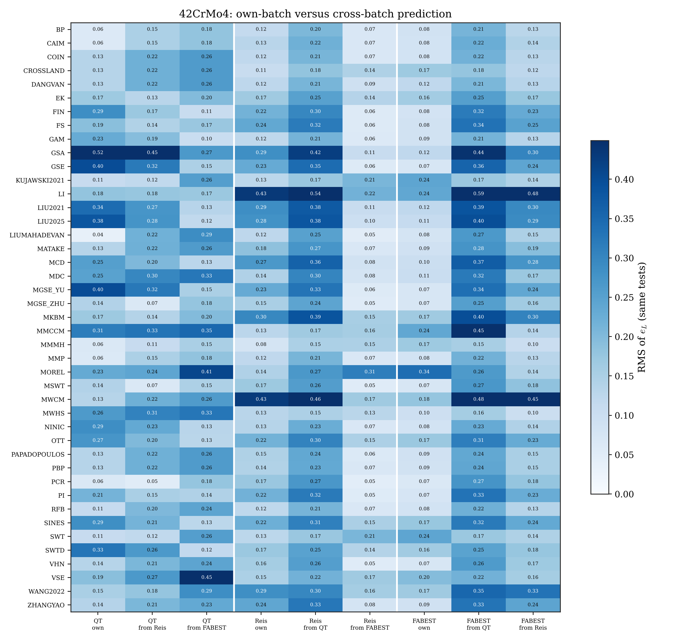

# Cross-batch comparison of the methods

Issue [#71](https://github.com/andreachiocca/multiaxial-fatigue/issues/71). Several workbooks are
batches of the same material. This page asks two questions of every method:

1. Does its error, measured on each batch with that batch's own calibration, change from one
   batch to the next? If so, is the change specific to the method, or is it common to all methods?
2. How well does it predict one batch from the constants, design set and master curve of another
   batch (cross-batch transfer)?

The first question measures how well a method fits a batch. The second measures how well it
predicts a batch it was not calibrated on, which is what a user relying on handbook data does
(CLAUDE.md, §1: "an error statistic on calibration tests measures the fit, not predictive
accuracy").

## Families

A batch is one workbook (decision [d101](decision-log.md#d101)). Families are declared in
[`examples/data/material_families.json`](../examples/data/material_families.json).

| Family | Batch | Source | Su / Sy (MPa) | Specimens | R = −1 failures (axial / torsion) | Multiaxial failures |
| --- | --- | --- | --- | --- | --- | --- |
| 42CrMo4 | `42CrMo4_QT` | Santus 2018 + Benedetti 2022 (one batch, d101) | 875 / 727 | solid, axial d = 5, torsion d = 14 mm | 27 / 9 (+ 9 torsion with mean shear) | none |
| 42CrMo4 | `42CrMo4_Reis` | Anes/Reis 2014 | 1100 / 980 | solid, d = 6.3 / 7.5 mm | 6 / 5 | 8 in-phase, 6 at 90° |
| 42CrMo4 | `42CrMo4_FABEST` | FABEST PBS series | 1111 / 1035 | thin-walled tube 8.1/7 mm | 20 / 20 | 18 in-phase, 21 at 90° |

The fatigue limits of `42CrMo4_Reis` and `42CrMo4_FABEST` are the authors' strengths at
$10^6$ cycles (decisions [d100](decision-log.md#d100) and the FABEST conversion).

## How to run

```bash
uv run python examples/batch_comparison.py all <tmp_dir> --jobs 4   # pipeline runs + analysis
uv run python examples/batch_comparison.py analyse <tmp_dir>        # analysis of existing runs
uv run python examples/batch_comparison.py check                    # are the committed results current?
```

`run` calls `multifat-pipeline` once on the batches (own batch) and once per design batch with
`--design-material` (transfer). `analyse` writes:

- `examples/data/batch_comparison/<family>/`: the CSV tables, two LaTeX tables and `manifest.json`;
- `docs/images/batch_comparison_<family>_bias.png` and `_transfer.png`.

The manifest records the registered models, the implementation revision and the dataset
fingerprints. `tests/test_batch_comparison.py` fails when one of them changes, so the results are
regenerated with every new method, change of method revision or change of data
([adding methods](adding-methods.md)).

## Statistics

All statistics use the load-equivalent error of the assessed failures (Flag 1):

$$e_L = \ln\frac{1}{s^*}$$

Here $s^*$ is the load factor that moves the test onto the method's life curve
([#37](https://github.com/andreachiocca/multiaxial-fatigue/issues/37)). The errors are grouped by
loading path: `A` (axial), `T` (torsion), `AT-IP` (in-phase tension–torsion), `AT-NP`
(out-of-phase), with `+mean` for a non-zero mean stress. Batches are compared within a path only:
pooling paths would compare the batches on different loads (Simpson's paradox).

| Output | Statistic |
| --- | --- |
| `own_cells.csv` | per method, batch and path: $n$, bias $\bar e_L$ with a 95 % percentile-bootstrap interval (4000 resamples, fixed seed), SD, RMS, share within ±20 % of the load, interaction residual |
| `own_batch_effect.csv` | per method and path: Kruskal–Wallis test of equal $e_L$ across batches ($n \ge 3$ per batch); Benjamini–Hochberg $q$ over the methods of the path |
| `own_two_way.csv`, `own_two_way.tex` | per path and every subset of $\ge 2$ batches, on the methods present on all of them: additive decomposition of the cell biases |
| `transfer_cells.csv` | per method, design → target pair and path: the statistics of `own_cells.csv` on every failure of the target |
| `transfer_penalty.csv`, `transfer_summary.*` | per method and pair: RMS of $e_L$ own batch versus transfer, on the same tests (those the own-batch run assesses, paired by `Observation_id`) |
| `batch_reference.csv` | method-free: Basquin fits of the R = −1 axial and torsion failures of each batch, and $\tau_a/\sigma_a$ at $10^5$ and $10^6$ cycles |

The additive decomposition is

$$\bar e_{mb} = \mu + \alpha_m + \beta_b + (\alpha\beta)_{mb}, \qquad \sum_m \alpha_m = \sum_b \beta_b = 0$$

In it:

- $\beta_b$ is the **batch offset**, common to all methods;
- $\alpha_m$ is the method effect;
- $(\alpha\beta)_{mb}$ is the method × batch interaction.

When the interaction RMS is of the order of the standard error of a cell mean, the batch only
shifts every method by the same amount, and the ranking of the methods carries over from one
batch to another. Rank correlations between batches are not reported: ties (the limit-based
methods share one torsion error) and common offsets make them uninformative.

### Cross-batch transfer

`multifat-pipeline --material B --design-material A` (decision [d102](decision-log.md#d102)) takes
everything that describes the material's resistance from A:

- the Summary properties;
- the calibrated plane constants and the Basquin constants;
- the design set and the master curve, or the native life fit.

It then assesses every failure of B. The load histories of B, strains included, are those
imported with B's own E and ν: they describe the tests, not the material model. The design rows
(Flag 0) of the output are A's tests, identical to A's own run.

### Caveats

- The points of one S-N curve share the lot, the machine and the laboratory. They are not
  independent, so the p-values and intervals are optimistic.
- Some cells are small: `42CrMo4_Reis` has 5–8 failures per path.
- The own-batch errors use a design set from the same batch. Only the transfer measures
  prediction.
- A batch offset can come from the material or from the test method. Examples are the specimen
  geometry (solid or thin-walled), the reference radius of the shear stress, and how the
  strengths at $10^6$ were obtained. The comparison cannot separate the two.

## Results: 42CrMo4

Run of 10 November 2026: 43 methods ran on every batch. TVEIT2025 and SSF were skipped because
their constants are not in the workbooks, and GOLOS because the loading is out of its scope. The
tables are in [`examples/data/batch_comparison/42CrMo4/`](../examples/data/batch_comparison/42CrMo4/).



**1. Own batch: the batch shifts all methods together.** The additive decomposition of the cell
biases (`own_two_way.tex`):

| Path | Batches | Methods | $\beta_\mathrm{QT}$ | $\beta_\mathrm{Reis}$ | $\beta_\mathrm{FABEST}$ | Interaction RMS | Cell SE | Method SD |
| --- | --- | --- | --- | --- | --- | --- | --- | --- |
| T | 3 | 33 | +0.097 | +0.015 | −0.112 | 0.043 | 0.022 | 0.141 |
| AT-IP | 2 | 43 | — | +0.061 | −0.061 | 0.023 | 0.014 | 0.047 |
| AT-NP | 2 | 42 | — | +0.095 | −0.095 | 0.036 | 0.017 | 0.157 |

- **The offsets are mostly common to all methods.** The interaction is about twice the standard
  error of a cell mean, but smaller than the batch offsets and much smaller than the spread
  between methods (except for in-phase loading).
- **The batch matters as much as the method under in-phase tension–torsion.** There the batch
  offset (±0.06, about ±6 % of the load) is larger than the method SD (0.047).
- **The batch effect is significant almost everywhere.** It is significant for 33/33 methods in
  torsion, 40/43 in-phase and 41/42 out-of-phase (Benjamini–Hochberg $q < 0.05$).
- **The largest interactions are:**
  - MOREL in torsion (FABEST −0.49);
  - MWCM at 90° on Reis (+0.75);
  - MWHS, whose design set is the torsion curve and which therefore deviates from the pattern of
    the axially calibrated methods.

**2. The offsets follow the batch's own torsion-to-axial strength ratio.** This ratio comes from
the method-free Basquin fits (`batch_reference.csv`):

| Batch | $\tau_a/\sigma_a$ at $10^5$ | at $10^6$ | Su (MPa) |
| --- | --- | --- | --- |
| QT | 0.82 | 0.87 | 875 |
| Reis | 0.80 | 0.85 | 1100 |
| FABEST | 0.66 | 0.72 | 1111 |

The thin-walled FABEST tubes have the lowest ratio; the solid QT and Reis specimens are close to
each other. Whether this difference is a property of the material or of the specimens (stress
gradient in solid torsion bars, the shear reference radius of the tubes) cannot be decided from
these data.



**3. Transfer: prediction is worse than fit, and the direction of the error depends on the
batch.** These are medians over the 43 methods, on the tests each own-batch run assesses
(`transfer_penalty.csv`):

| Design → target | RMS own | RMS transfer | Methods worse | Median bias (transfer) |
| --- | --- | --- | --- | --- |
| QT → Reis | 0.159 | 0.256 | 100 % | +0.244 |
| QT → FABEST | 0.096 | 0.265 | 91 % | +0.246 |
| Reis → FABEST | 0.096 | 0.171 | 84 % | +0.127 |
| FABEST → Reis | 0.159 | 0.080 | 16 % | −0.012 |
| Reis → QT | 0.167 | 0.206 | 53 % | −0.088 |
| FABEST → QT | 0.167 | 0.197 | 65 % | −0.165 |

- **Calibrating on the weaker QT batch (Su 875 MPa) is conservative for the stronger batches.**
  The bias is about +0.25, i.e. the tests sustain loads about 28 % higher than predicted.
- **Calibrating on Reis or FABEST is non-conservative for QT.** The bias is −0.09 and −0.17.
  Using data from a stronger lot of the same steel is the unsafe direction.
- **Reis and FABEST, the two high-strength batches, transfer well.** Reis predicted from FABEST is
  even better than Reis on its own: its design set has 6 axial failures over 1.6 decades of life,
  against FABEST's 20.
- **The method ranking is fairly stable.** The weighted RMS over the six pairs correlates with
  the own-batch RMS (Spearman 0.67, `transfer_summary.csv`).
  - The methods that transfer best are MMMH (RMS 0.135, the same as its own-batch value), BP,
    GAM, MMP and SWT/KUJAWSKI2021 (0.17).
  - LI (0.47) and MWCM (0.41) transfer worst.

These numbers are for one steel and three laboratories. They describe the batch-to-batch
scatter that a design with handbook data has to cover; they do not rank the methods in general.
